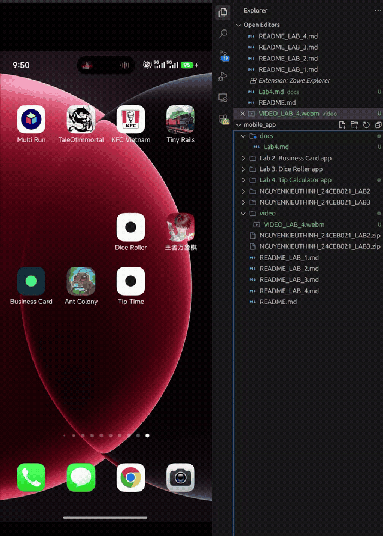
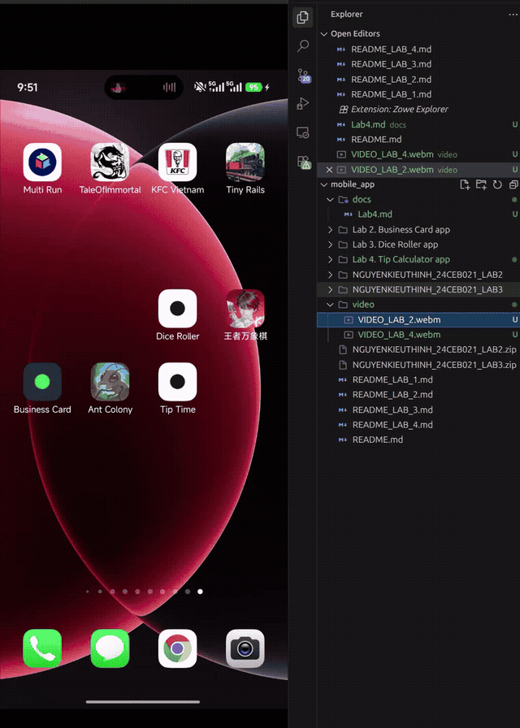
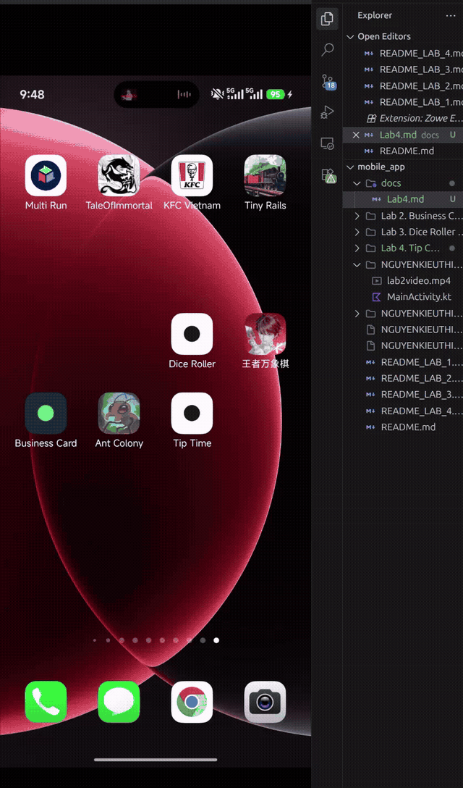
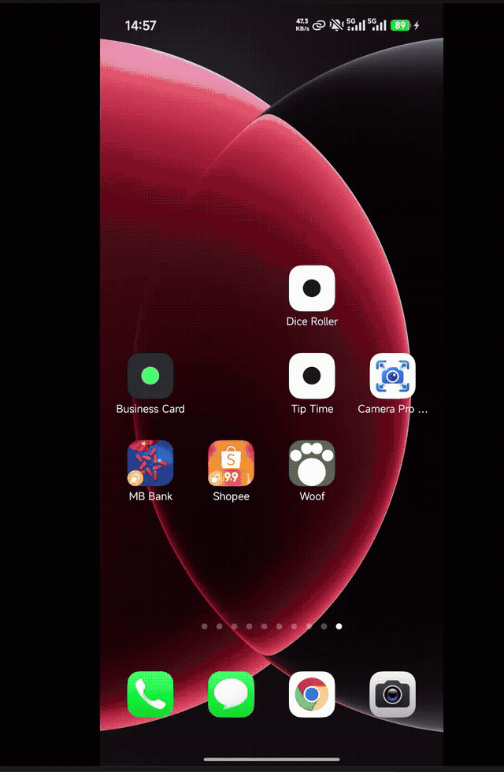
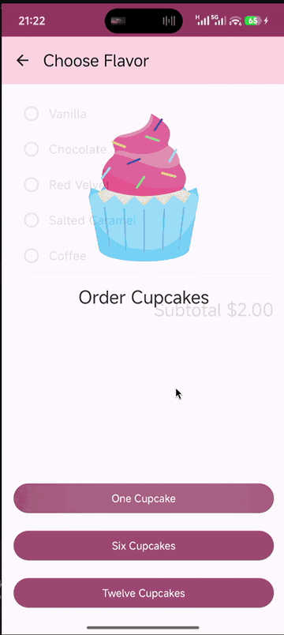
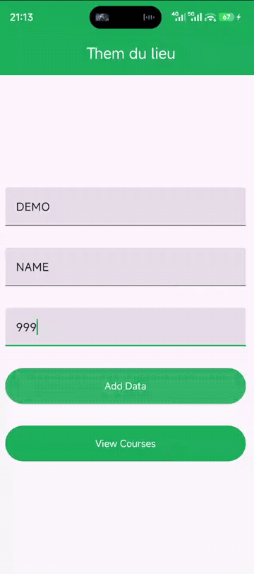
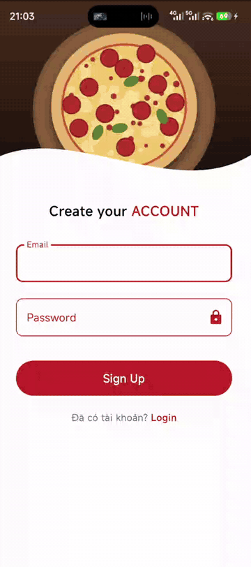
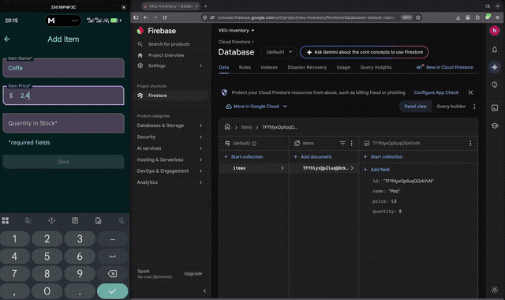
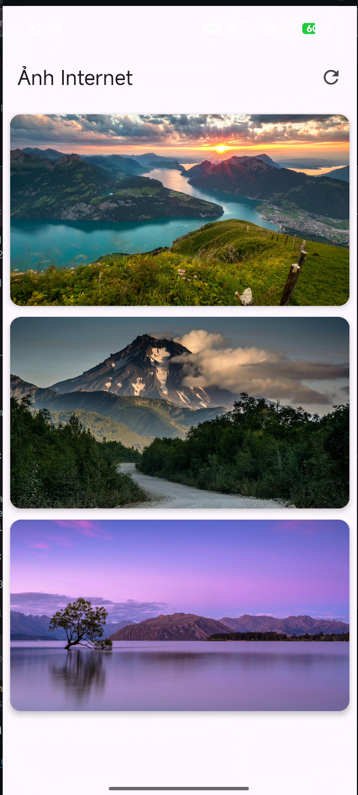
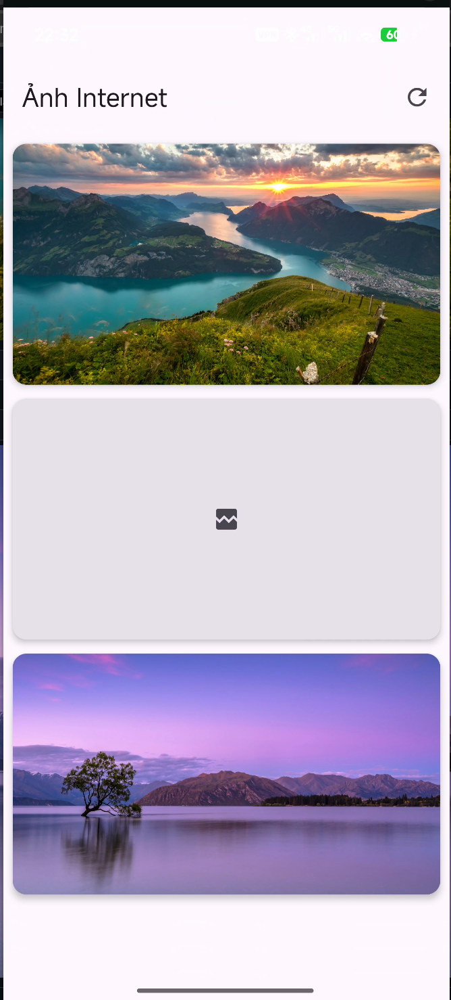

# VKU · Lập trình ứng dụng di động

**Bộ sưu tập bài thực hành Android với Jetpack Compose**

---

> Tổng hợp 10 ứng dụng Android được xây dựng bằng **Kotlin** và **Jetpack Compose**, từ giao diện cơ bản đến quản lý trạng thái, điều hướng, Cloud Firestore, Firebase Authentication và tải ảnh từ Internet. *(Lab 1 là bài làm quen công cụ, không có mã nguồn ứng dụng.)*

## Danh sách bài thực hành

| Lab | Ứng dụng | Nội dung chính | Chi tiết |
|:---:|----------|----------------|----------|
| 2 | Business Card | Layout cơ bản: `Column`, `Row`, `Image`, `Icon` | [Xem chi tiết](README_LAB_2.md) |
| 3 | Dice Roller | State & sự kiện: `remember`, `mutableIntStateOf`, `Button` | [Xem chi tiết](README_LAB_3.md) |
| 4 | Tip Calculator | State hoisting, `TextField`, `Switch`, tính toán | [Xem chi tiết](README_LAB_4.md) |
| 5 | Woof | Material 3 Theming: Color Scheme, Typography, Shape, Dark Theme | [Xem chi tiết](README_LAB_5.md) |
| 6 | Cupcake | Navigation Compose, ViewModel, StateFlow, đặt hàng | [Xem chi tiết](README_LAB_6.md) |
| 7 | Firebase CRUD | Cloud Firestore: Thêm / Đọc / Sửa / Xóa, `addSnapshotListener` | [Xem chi tiết](README_LAB_7.md) |
| 8 | Pizzeria | Firebase Authentication: đăng ký / đăng nhập / đăng xuất bằng Email + Password | [Xem chi tiết](README_LAB_8.md) |
| 9 | Inventory | Cloud Firestore: thêm, đọc, sửa, xóa mặt hàng | [Xem chi tiết](README_LAB_9.md) |
| 10 | Load ảnh từ Internet | Coil, danh sách URL cập nhật từ GitHub, tối đa 20 ảnh | [Xem chi tiết](README_LAB_10.md) |

## GIF demo

| Lab 2 · Business Card | Lab 3 · Dice Roller | Lab 4 · Tip Calculator |
|:---------------------:|:-------------------:|:----------------------:|
|  |  |  |

| Lab 5 · Woof | Lab 6 · Cupcake | Lab 7 · Firebase CRUD |
|:------------:|:---------------:|:---------------------:|
|  |  |  |

| Lab 8 · Pizzeria | Lab 9 · Inventory |
|:----------------:|:-----------------:|
|  |  |

### Lab 10 · Load ảnh từ Internet

| Tải ảnh thành công | Trạng thái khi ảnh lỗi |
|:---:|:---:|
|  |  |

---

**Bắt đầu xem từ [README_LAB_2.md](README_LAB_2.md) → [README_LAB_3.md](README_LAB_3.md) → [README_LAB_4.md](README_LAB_4.md) → [README_LAB_5.md](README_LAB_5.md) → [README_LAB_6.md](README_LAB_6.md) → [README_LAB_7.md](README_LAB_7.md) → [README_LAB_8.md](README_LAB_8.md) → [README_LAB_9.md](README_LAB_9.md) → [README_LAB_10.md](README_LAB_10.md)**

