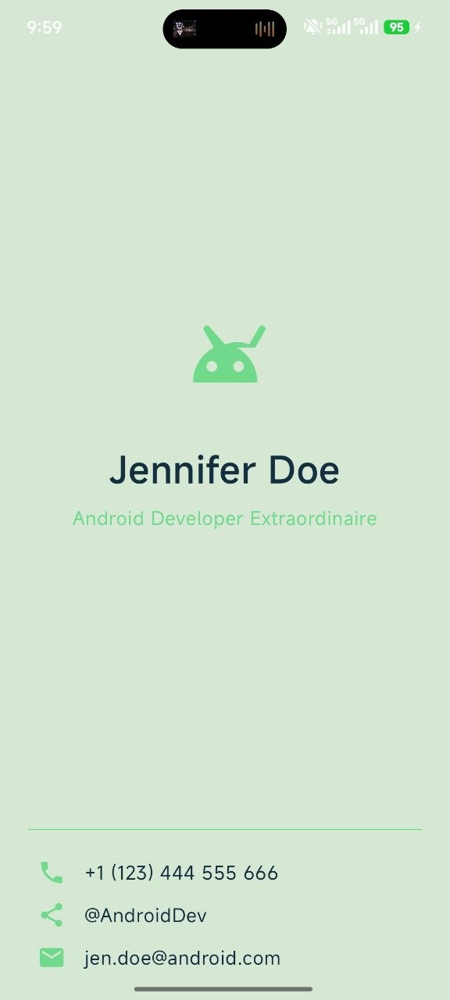
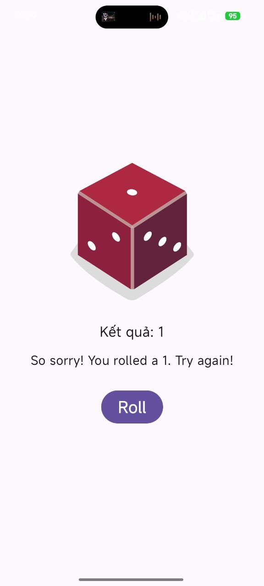
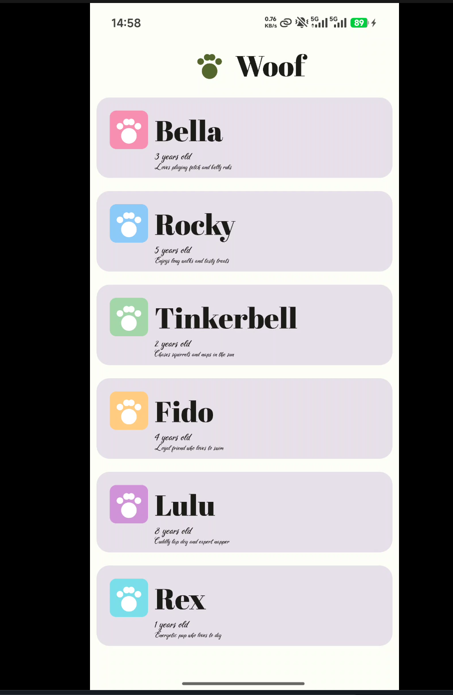
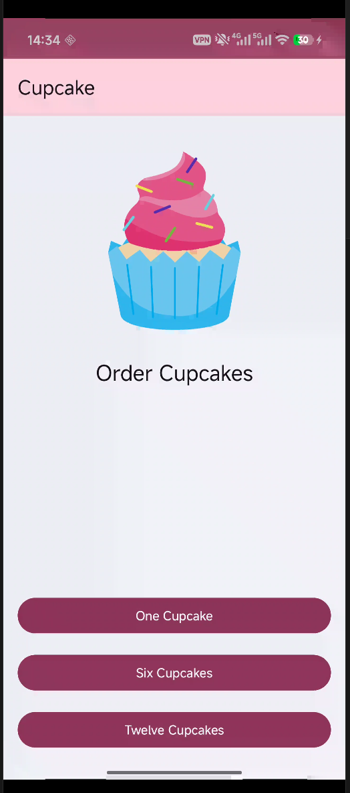

# VKU · Lập trình ứng dụng di động

**Bộ sưu tập bài thực hành Android với Jetpack Compose**

---

> Tổng hợp 8 ứng dụng Android được xây dựng từ đầu bằng **Kotlin** và **Jetpack Compose**, đi từ làm quen giao diện cơ bản đến quản lý trạng thái (state), tương tác người dùng, Material Theming, điều hướng đa màn hình, lưu trữ dữ liệu cục bộ bằng **Room** và lưu trữ trực tuyến / xác thực người dùng với **Firebase**. *(Lab 1 là bài làm quen công cụ, không có mã nguồn ứng dụng.)*

## Danh sách bài thực hành

| Lab | Ứng dụng | Nội dung chính | Chi tiết |
|:---:|----------|----------------|----------|
| 2 | Business Card | Layout cơ bản: `Column`, `Row`, `Image`, `Icon` | [Xem chi tiết](README_LAB_2.md) |
| 3 | Dice Roller | State & sự kiện: `remember`, `mutableIntStateOf`, `Button` | [Xem chi tiết](README_LAB_3.md) |
| 4 | Tip Calculator | State hoisting, `TextField`, `Switch`, tính toán | [Xem chi tiết](README_LAB_4.md) |
| 5 | Woof | Material 3 Theming: Color Scheme, Typography, Shape, Dark Theme | [Xem chi tiết](README_LAB_5.md) |
| 6 | Cupcake | Navigation Compose, ViewModel, StateFlow, đặt hàng | [Xem chi tiết](README_LAB_6.md) |
| 7 | Firebase CRUD | Cloud Firestore: Thêm / Đọc / Sửa / Xóa, `addSnapshotListener` | [Xem chi tiết](README_LAB_7.md) |
| 8 | Pizzeria | Firebase Authentication: đăng ký / đăng nhập / đăng xuất bằng Email + Password | [Xem chi tiết](README_LAB_8.md) |
| 9 | Inventory | Room + SQLite: `@Entity`, `@Dao`, `@Database`, repository, lưu item khi bấm Save | [Xem chi tiết](README_LAB_9.md) |

## Video demo

| Lab | Ứng dụng | Link video |
|:---:|----------|:----------:|
| 2 | Business Card | [▶ Xem video](https://github.com/user-attachments/assets/b9ac1e9a-b44b-49f4-92cc-eb7eca6780f7) |
| 3 | Dice Roller | [▶ Xem video](https://github.com/user-attachments/assets/8facb0d1-aefd-46f5-a906-2daeefa00906) |
| 4 | Tip Calculator | [▶ Xem video](https://github.com/user-attachments/assets/ebc38e7d-d93e-4e6e-8602-26c859a67d8d) |
| 5 | Woof | [▶ Xem video](https://github.com/user-attachments/assets/aad9f193-5be5-43d5-843a-2b8058e601b3) |
| 6 | Cupcake | [▶ Xem video](https://github.com/user-attachments/assets/f46eb5ac-a99f-4f72-9ffa-5d771bdae3aa) |
| 7 | Firebase CRUD | *Video demo sẽ được cập nhật.* |
| 8 | Pizzeria | [▶ Xem video](https://github.com/user-attachments/assets/9f9c5f75-93ea-43c5-9c1c-bbd37f95ce16) |
| 9 | Inventory | *Video demo sẽ được cập nhật.* |

## Ảnh minh họa

| Lab 2 · Business Card | Lab 3 · Dice Roller | Lab 4 · Tip Calculator |
|:---------------------:|:-------------------:|:----------------------:|
|  |  |  |

| Lab 5 · Woof | Lab 6 · Cupcake | Lab 7 · Firebase CRUD |
|:------------:|:---------------:|:---------------------:|
|  |  |  |

| Lab 8 · Pizzeria | Lab 9 · Inventory |
|:----------------:|:-----------------:|
|  |  |

---

**Bắt đầu xem từ [README_LAB_2.md](README_LAB_2.md) → [README_LAB_3.md](README_LAB_3.md) → [README_LAB_4.md](README_LAB_4.md) → [README_LAB_5.md](README_LAB_5.md) → [README_LAB_6.md](README_LAB_6.md) → [README_LAB_7.md](README_LAB_7.md) → [README_LAB_8.md](README_LAB_8.md) → [README_LAB_9.md](README_LAB_9.md)**

