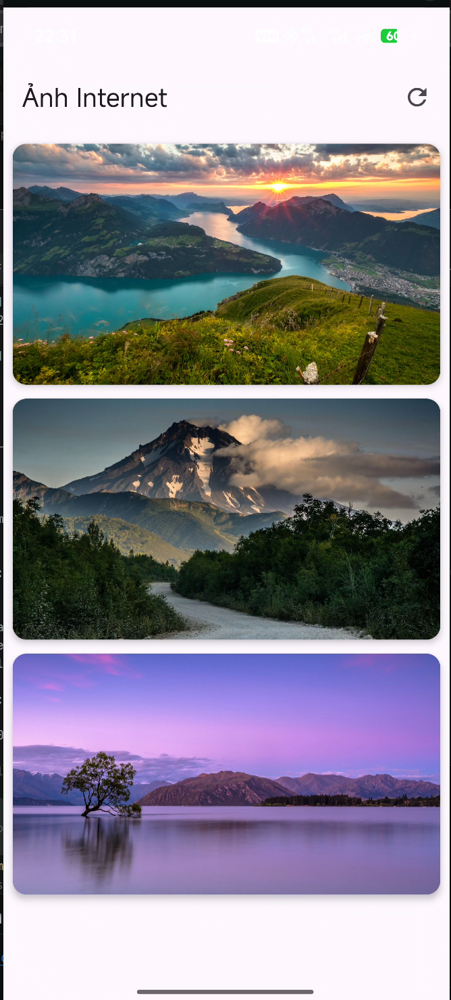
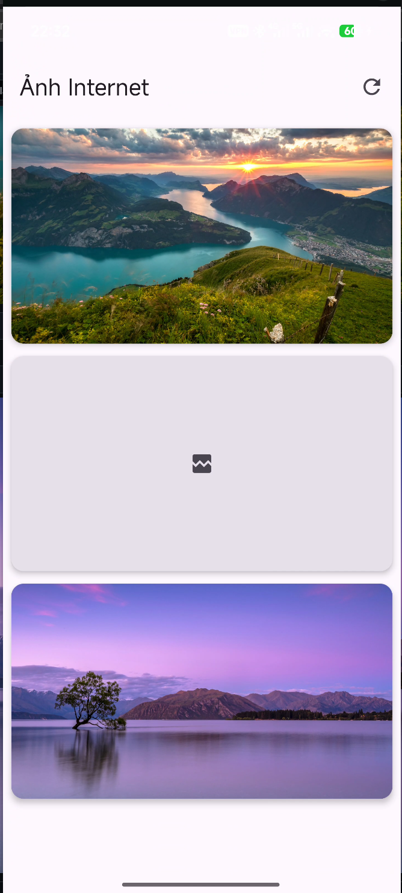

# Lab 10 · Load ảnh từ Internet

Ứng dụng Jetpack Compose tải danh sách URL từ một file trên GitHub rồi dùng Coil để tải và hiển thị ảnh Internet.

## Tính năng

- Đọc các URL trong file `Lab 10. Mars Photos app/img/image-links.txt` trên GitHub Raw.
- Hiển thị tối đa 20 ảnh bằng `LazyVerticalGrid`, mỗi hàng có một ảnh.
- Nút tải lại lấy danh sách URL mới sau khi file GitHub được cập nhật.
- Hiển thị trạng thái đang tải, lỗi ảnh, lỗi mạng và nút thử lại.
- Giao diện và trạng thái được viết bằng Kotlin/Jetpack Compose, không dùng XML layout.

## Ảnh ứng dụng

| Tải ảnh thành công | Một ảnh không tải được |
|:---:|
|  |  |

## Ảnh mẫu

Mỗi dòng trong `img/image-links.txt` là một URL ảnh HTTPS. Hiện file có 3 ảnh. Để thêm ảnh, thêm URL mới vào file rồi push lên GitHub; bấm nút tải lại trong app để lấy danh sách mới. App bỏ URL trùng và chỉ hiển thị tối đa 20 ảnh.

| Hồ núi lúc hoàng hôn |
|:---:|
|  |
| Đường núi |
|  |
| Hồ Wanaka |
|  |

## Chạy ứng dụng

Mở thư mục `Lab 10. Mars Photos app` trong Android Studio, đồng bộ Gradle và chạy trên máy ảo hoặc thiết bị có Internet.

Ứng dụng chỉ cần quyền Internet. Lab này không dùng Firebase hoặc cấu hình dịch vụ Firebase.

## Tài liệu tham khảo

- [Android Basics with Compose: Load and display images from the internet](https://developer.android.com/codelabs/basic-android-kotlin-compose-load-images?hl=vi)
- [Coil](https://coil-kt.github.io/coil/)
