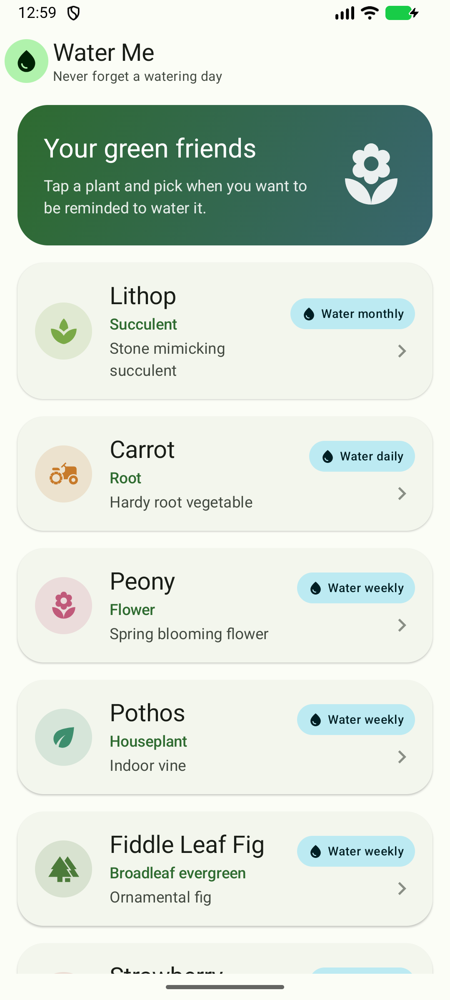
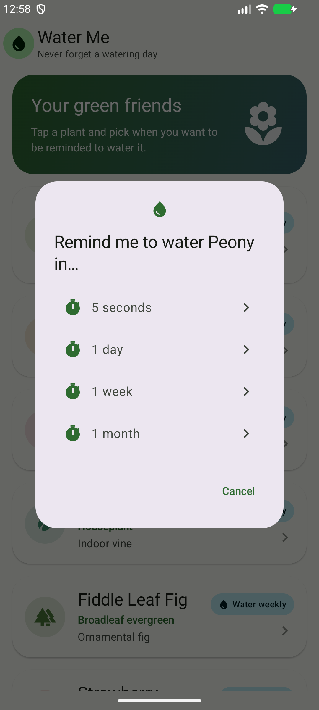
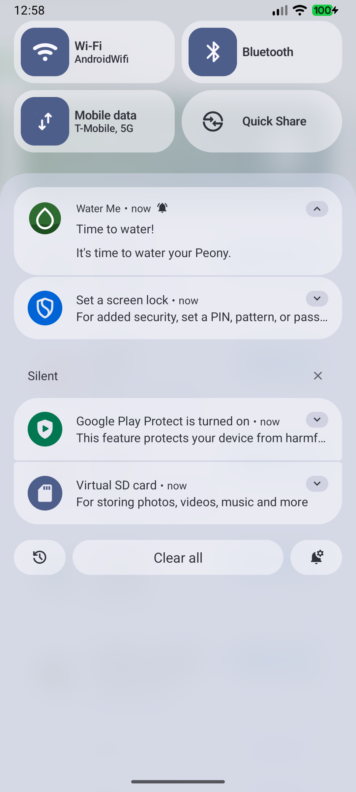
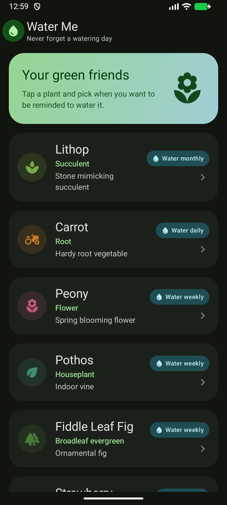

# Lab 11 · Water Me

Ứng dụng nhắc tưới cây bằng **Jetpack Compose** và **WorkManager**. Người dùng chạm vào một loài cây, chọn thời gian nhắc (5 giây, 1 ngày, 1 tuần hoặc 1 tháng) rồi nhận thông báo khi đến giờ.

## Tính năng

- Hiển thị danh sách 6 loài cây với loại, mô tả và lịch tưới gợi ý.
- Chạm vào một cây để mở hộp thoại chọn thời gian nhắc.
- Đặt lời nhắc bằng `OneTimeWorkRequest` có `setInitialDelay(duration, unit)`.
- Truyền tên cây sang worker qua `Data` / `inputData`.
- Dùng `enqueueUniqueWork(..., ExistingWorkPolicy.REPLACE, ...)`; tên công việc là tên cây + thời lượng nên một cây có thể có nhiều lời nhắc khác nhau.
- `WaterReminderWorker` (CoroutineWorker) tạo notification channel và hiển thị thông báo "It's time to water your …".
- Xin quyền `POST_NOTIFICATIONS` trên Android 13+.
- Snackbar xác nhận ngay sau khi đặt lời nhắc.
- Giao diện Material 3, hỗ trợ dark mode và edge-to-edge.

## Video demo

[▶ Xem video demo](video/lab11_demo.mp4)

Video quay trực tiếp trên emulator: chạm vào cây, đặt lời nhắc 5 giây, chờ thông báo, mở notification shade, chạm thông báo để mở lại app và kiểm tra dark mode.

## Ảnh ứng dụng

| Danh sách cây | Chọn thời gian nhắc | Thông báo nhắc tưới |
|:---:|:---:|:---:|
|  |  |  |

| Dark mode |
|:---:|
|  |

## Luồng hoạt động

1. `WaterMeApp` lấy danh sách cây từ `WaterViewModel`.
2. Chạm vào một cây → mở `ReminderDialogContent` với 4 lựa chọn thời gian.
3. Chọn thời gian → `WaterViewModel.scheduleReminder()` → `WorkManagerWaterRepository.scheduleReminder()`.
4. Repository tạo `Data` chứa tên cây, tạo `OneTimeWorkRequest` cho `WaterReminderWorker` với thời gian trễ ban đầu, rồi đưa vào hàng đợi bằng `enqueueUniqueWork()`.
5. Khi hết thời gian, WorkManager chạy worker; worker đọc tên cây từ `inputData`, tạo notification channel và đăng thông báo.
6. Ứng dụng hiện snackbar xác nhận và đóng hộp thoại.

## Cấu trúc mã nguồn

```text
app/src/main/java/com/example/waterme/
├── Constants.kt                     # Channel ID, mã thông báo, thời lượng
├── MainActivity.kt                  # Compose entry point + xin quyền thông báo
├── WaterMeApplication.kt            # Khởi tạo AppContainer
├── data/
│   ├── AppContainer.kt              # Dependency container thủ công
│   ├── DataSource.kt                # Danh sách cây mẫu
│   ├── Reminder.kt                  # Một lựa chọn thời gian nhắc
│   ├── WaterRepository.kt           # Interface repository
│   └── WorkManagerWaterRepository.kt# Lên lịch lời nhắc với WorkManager
├── model/Plant.kt                   # Model cây (Parcelable)
├── ui/
│   ├── WaterMeApp.kt                # Danh sách cây + hộp thoại + snackbar
│   ├── WaterViewModel.kt            # ViewModel + Factory
│   └── theme/                       # Material 3 color scheme, typography
└── worker/
    ├── WaterReminderWorker.kt       # CoroutineWorker đăng thông báo
    └── WorkerUtils.kt               # Tạo channel và notification
```

## Đoạn mã chính

`WorkManagerWaterRepository.scheduleReminder()`:

```kotlin
override fun scheduleReminder(duration: Long, unit: TimeUnit, plantName: String) {
    val inputData = Data.Builder()
        .putString(WaterReminderWorker.nameKey, plantName)
        .build()

    val workRequest = OneTimeWorkRequestBuilder<WaterReminderWorker>()
        .setInitialDelay(duration, unit)
        .setInputData(inputData)
        .build()

    workManager.enqueueUniqueWork(
        reminderWorkName(plantName, duration),
        ExistingWorkPolicy.REPLACE,
        workRequest
    )
}
```

`WaterReminderWorker.doWork()`:

```kotlin
override suspend fun doWork(): Result {
    val plantName = inputData.getString(nameKey) ?: return Result.failure()

    makePlantReminderNotification(
        applicationContext.resources.getString(R.string.time_to_water, plantName),
        applicationContext
    )

    return Result.success()
}
```

Tên unique work gồm cả tên cây và thời lượng, ví dụ `Peony-5` và `Peony-1`, nên có thể đặt đồng thời lời nhắc 5 giây và 1 ngày cho cùng một cây mà không ghi đè lẫn nhau.

## Chạy ứng dụng

1. Mở thư mục `Lab 11. Water Me app` bằng Android Studio và đồng bộ Gradle.
2. Chạy trên máy ảo hoặc thiết bị Android 8.0 (API 26) trở lên.
3. Trên Android 13+, cấp quyền thông báo khi ứng dụng hỏi.
4. Chạm một cây → chọn **5 seconds** → kéo thanh thông báo xuống để xem lời nhắc.

> WorkManager có thể trễ vài giây so với thời điểm hẹn do cơ chế tối ưu pin của hệ thống. Lựa chọn 5 giây dùng để demo nhanh; với lời nhắc thật nên dùng 1 ngày, 1 tuần hoặc 1 tháng.

Nếu không thấy thông báo, kiểm tra quyền thông báo của ứng dụng, chế độ Không làm phiền và tính năng tối ưu pin.

## Kiểm thử

```bash
./gradlew testDebugUnitTest
```

Ba unit test trong `ReminderWorkNameTest` kiểm tra tên unique work: cùng cây + cùng thời lượng cho cùng tên, khác thời lượng hoặc khác cây cho tên khác nhau.

## Hướng mở rộng

Thử thách tùy chọn của codelab: đổi 4 lựa chọn trong `ReminderDialogContent` thành 5 giây, 1 phút, 2 phút và 3 phút, sau đó kiểm tra từng lựa chọn.

## Tài liệu tham khảo

- [Android Basics with Compose: Practice — Water Me app](https://developer.android.com/codelabs/basic-android-kotlin-compose-practice-water-me-app?hl=vi)
- [WorkManager overview](https://developer.android.com/topic/libraries/architecture/workmanager)
- [Create and manage notification channels](https://developer.android.com/develop/ui/views/notifications/channels)
- [Notification runtime permission](https://developer.android.com/develop/ui/views/notifications/notification-permission)
