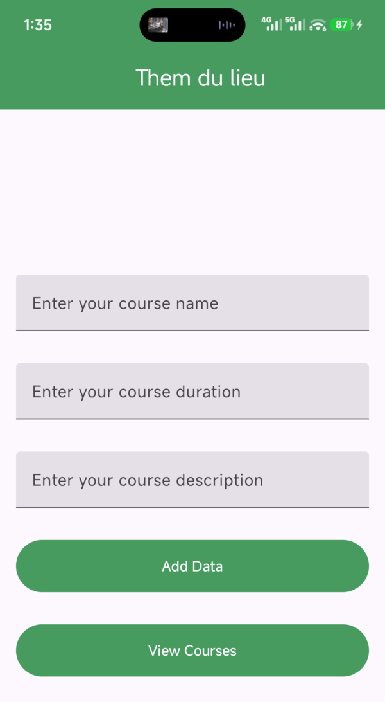
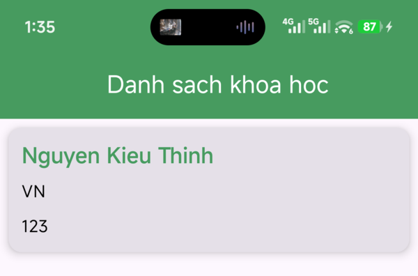
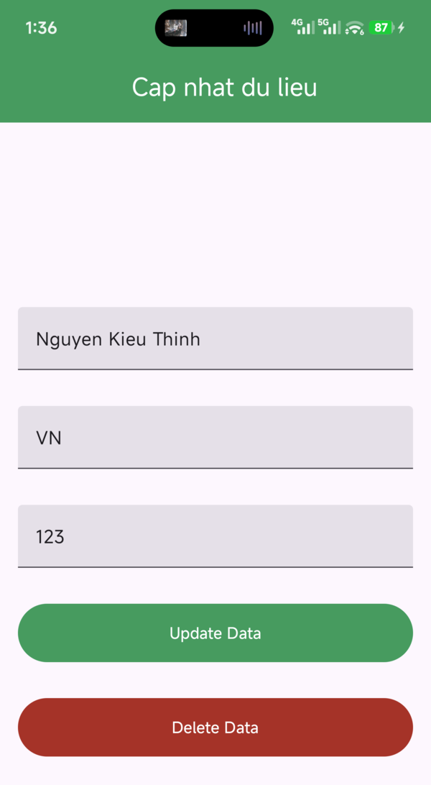

<div align="center">

# Firebase CRUD

**Lab 7 · Android với Jetpack Compose**

[](https://kotlinlang.org)
[](https://developer.android.com/jetpack/compose)
[](https://firebase.google.com)
[](https://firebase.google.com/docs/firestore)
[](https://m3.material.io)

</div>

---

> Ứng dụng **Firebase CRUD** — quản lý danh sách khóa học với đầy đủ 4 thao tác **Thêm / Đọc / Sửa / Xóa** lưu trữ trên **Cloud Firestore**. Dữ liệu được đọc theo thời gian thực bằng `addSnapshotListener`, màn hình danh sách tự cập nhật ngay khi có thay đổi mà không cần mở lại.

---

## Video demo

<!-- Dán link video demo Lab 7 vào đây, cùng dạng với các lab trước:
<video src="LINK_VIDEO_DEMO" controls width="100%"></video>
-->

> *Video demo sẽ được cập nhật.*

## Ảnh minh họa

<div align="center">

| Thêm dữ liệu | Danh sách khóa học | Cập nhật / Xóa |
|:------------:|:------------------:|:--------------:|
|  |  |  |

</div>

## Tính năng nổi bật

| Tính năng | Mô tả |
|-----------|--------|
| **Thêm** (Create) | Form 3 ô nhập, ghi document mới vào collection `Courses` bằng `.add()` |
| **Đọc** (Read) | Danh sách khóa học dạng `Card`, đọc realtime bằng `addSnapshotListener` |
| **Sửa** (Update) | Bấm vào một khóa học → form được điền sẵn dữ liệu cũ → ghi đè bằng `.set()` |
| **Xóa** (Delete) | Nút *Delete Data* màu đỏ trên màn hình cập nhật, xóa document bằng `.delete()` |
| Kiểm tra dữ liệu | Chặn submit khi bỏ trống ô nhập, hiện `Toast` nhắc từng ô |
| Tự cập nhật | Sau khi sửa/xóa, quay về danh sách và thấy kết quả ngay nhờ listener |
| Điều hướng | 3 màn hình: Thêm → Danh sách → Cập nhật, truyền dữ liệu qua `Intent` extra |

## Kiến thức áp dụng

| Khái niệm | Cách dùng |
|-----------|-----------|
| Cloud Firestore | `FirebaseFirestore.getInstance().collection("Courses")` |
| Thêm document | `.add(course)` — Firestore tự sinh document id |
| Ghi đè document | `.document(id).set(course)` |
| Xóa document | `.document(id).delete()` |
| Đọc realtime | `.addSnapshotListener { snap, err -> ... }` |
| Hủy listener | `DisposableEffect(Unit)` + `onDispose { registration.remove() }` |
| Ánh xạ dữ liệu | `data class` + `document.toObject(Course::class.java)` |
| `@Exclude` | Loại `courseID` khỏi document trên Firestore (chỉ giữ ở phía app) — **phải viết `@get:Exclude @field:Exclude`** |
| Lấy id document | Gán lại `courseID = document.id` sau khi `toObject()` |
| Danh sách động | `mutableStateListOf<Course>()` + `LazyColumn` |
| State hoisting | `CourseForm` nhận `init` + `onSubmit`, dùng chung cho cả Thêm và Sửa |
| Slot API | Tham số `extra: @Composable ColumnScope.() -> Unit` để chèn nút phụ |
| Điều hướng | `Intent` + `putExtra`/`getStringExtra`, cờ `CLEAR_TOP or SINGLE_TOP` |
| Material 3 | `Scaffold`, `TopAppBar`, `TextField`, `Card`, `Button` |

## Cấu trúc mã nguồn

| File | Vai trò |
|------|---------|
| `MainActivity.kt` | Màn hình **Thêm** + hàm `addDataToFirebase()` |
| `CourseDetailsActivity.kt` | Màn hình **Danh sách**, `CourseList()` và `addSnapshotListener` |
| `UpdateCourse.kt` | Màn hình **Cập nhật** + `updateDataToFirebase()`, `deleteCourse()` |
| `Course.kt` | `data class Course` — ánh xạ document Firestore |
| `Common.kt` | `AppScaffold()` (TopAppBar xanh dùng chung) và `CourseForm()` |
| `ui/theme/*` | Theme: `Color`, `Theme`, `Type` |

## Luồng hoạt động

```
MainActivity (Thêm dữ liệu)
      │  .add()                          Bấm "View Courses"
      ▼                                        │
Cloud Firestore  ◄──── addSnapshotListener ────┤
   collection "Courses"                        ▼
      ▲                            CourseDetailsActivity (Danh sách)
      │  .set() / .delete()                     │  Bấm vào 1 Card
      │                                          ▼
      └──────────────────────────────── UpdateCourse (Cập nhật / Xóa)
```

## Thiết lập Firebase

Ứng dụng cần một project Firebase riêng. Các bước:

1. Vào [Firebase Console](https://console.firebase.google.com) → **Add project**.
2. Thêm ứng dụng **Android** với package name `com.example.firebaseproject`.
3. Tải `google-services.json` và đặt vào **thư mục gốc** của module (cạnh `build.gradle.kts`).
4. Vào **Firestore Database → Create database** → chọn **Start in test mode**.
5. Mở tab **Rules**, sửa thành và bấm **Publish**:

```
rules_version = '2';
service cloud.firestore {
  match /databases/{database}/documents {
    match /{document=**} {
      allow read, write: if true;
    }
  }
}
```

> ⚠️ `if true` chỉ dùng cho môi trường học tập. Chế độ test mode của Firestore tự khóa lại sau khoảng 30 ngày — khi đó app sẽ báo lỗi `PERMISSION_DENIED`, chỉ cần vào **Rules** publish lại.

## Chạy dự án

```bash
cd "Lab 7. Firebase CRUD app"
./gradlew assembleDebug      # Build APK
./gradlew installDebug       # Cài lên thiết bị qua adb
```

**Mã nguồn chính:** [`src/main/java/com/example/firebaseproject/MainActivity.kt`](Lab%207.%20Firebase%20CRUD%20app/src/main/java/com/example/firebaseproject/MainActivity.kt)

## Lỗi thường gặp

| Lỗi | Nguyên nhân & cách xử lý |
|-----|--------------------------|
| `PERMISSION_DENIED: Missing or insufficient permissions` | Chưa **Publish Rules** (còn `if false`), hoặc test mode đã hết hạn → publish lại rules ở bước 5 |
| `Cloud Firestore API has not been used in project ... or it is disabled` | Chưa tạo Firestore Database trong Console → **Create database** |
| `File google-services.json is missing` | Chưa đặt `google-services.json` vào thư mục gốc module |
| Không có mạng / không đọc được dữ liệu | Thiếu `INTERNET` permission trong `AndroidManifest.xml` |
| Danh sách trống nhưng Console có dữ liệu | Sai tên collection (phải là `Courses`) hoặc sai project Firebase |
| Document thừa field `courseID: ""` | `@Exclude` viết trần chỉ được Kotlin gắn lên **field**, nhưng Firestore quét **getter** trước nên property vẫn bị ghi → phải dùng `@get:Exclude @field:Exclude` |

<div align="center">

[← Lab 6 · Cupcake](README_LAB_6.md) · [Về trang chủ](README.md)

</div>
