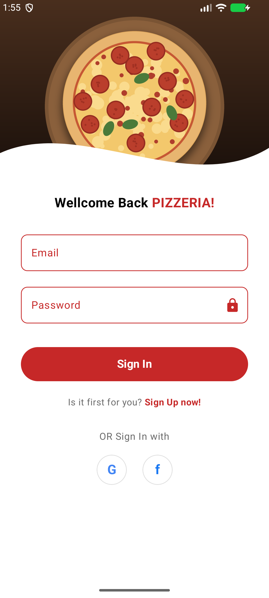
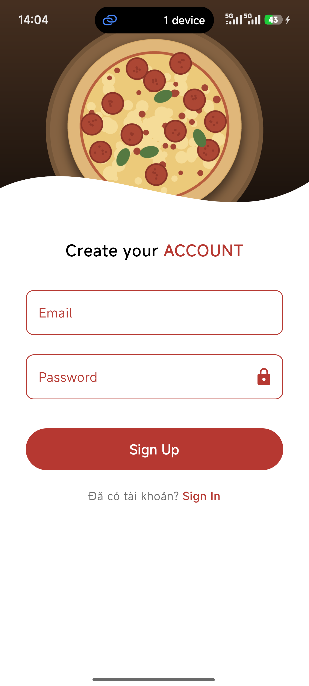
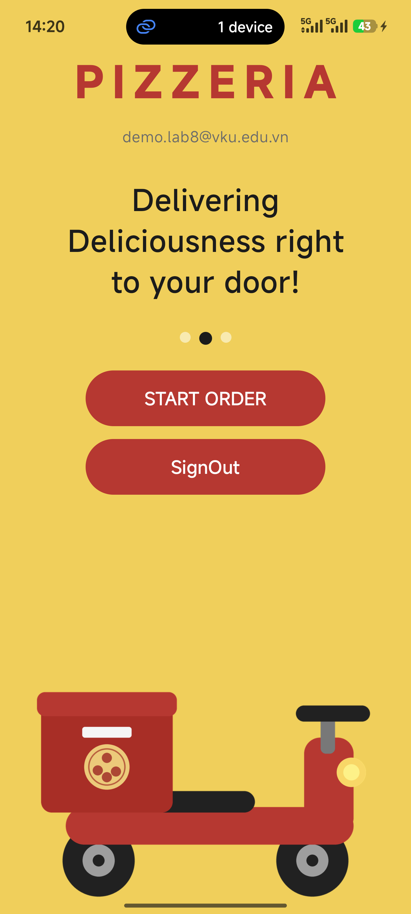

<div align="center">

# Pizzeria

**Lab 8 · Android với Jetpack Compose**

[](https://kotlinlang.org)
[](https://developer.android.com/jetpack/compose)
[](https://firebase.google.com)
[](https://firebase.google.com/docs/auth)
[](https://developer.android.com/jetpack/compose/navigation)

</div>

---

> Ứng dụng **Pizzeria** — đăng ký / đăng nhập / đăng xuất bằng **Firebase Authentication** với phương thức **Email + Password**, giao diện viết hoàn toàn bằng **Jetpack Compose** và điều hướng bằng **Navigation Compose**. Sau khi đăng nhập, người dùng được đưa sang màn hình chào mừng và có thể đăng xuất để quay về màn hình đăng nhập.

---

## Video demo

<video src="https://github.com/user-attachments/assets/9f9c5f75-93ea-43c5-9c1c-bbd37f95ce16" controls width="100%"></video>

## Ảnh minh họa

<div align="center">

| Đăng nhập | Đăng ký | Sau khi đăng nhập |
|:---------:|:-------:|:-----------------:|
|  |  |  |

</div>

## Tính năng nổi bật

| Tính năng | Mô tả |
|-----------|--------|
| **Đăng nhập** | `signInWithEmailAndPassword()` → thành công chuyển sang `Home`, thất bại hiện `Toast` lỗi |
| **Đăng ký** | `createUserWithEmailAndPassword()` → tạo tài khoản trên Firebase rồi vào thẳng `Home` |
| **Đăng xuất** | `signOut()` trên màn hình Home → quay về màn hình đăng nhập |
| Kiểm tra dữ liệu | Chặn submit khi bỏ trống ô nhập, hiện `Toast` *Empty Fields Are not Allowed !!* |
| Kiểm tra mật khẩu | Đăng ký yêu cầu mật khẩu **tối thiểu 6 ký tự** (đúng giới hạn của Firebase) |
| Nhớ phiên đăng nhập | Firebase tự lưu phiên — mở lại app vào thẳng `Home`, không bắt đăng nhập lại |
| Hiển thị người dùng | Màn hình Home hiện email của tài khoản đang đăng nhập |
| Điều hướng | `NavHost` 3 màn hình `SignIn` → `SignUp` → `Home`, `popUpTo` để không quay lại màn hình cũ |
| Giao diện | Ảnh pizza header uốn sóng, ô nhập viền đỏ, nút tròn Google/Facebook (chỉ là giao diện) |

## Kiến thức áp dụng

| Khái niệm | Cách dùng |
|-----------|-----------|
| Firebase Authentication | `FirebaseAuth.getInstance()` |
| Đăng nhập | `.signInWithEmailAndPassword(email, password)` |
| Đăng ký | `.createUserWithEmailAndPassword(email, password)` |
| Đăng xuất | `.signOut()` |
| Lấy người dùng hiện tại | `firebaseAuth.currentUser?.email` |
| Lắng nghe kết quả | `.addOnCompleteListener { task -> task.isSuccessful / task.exception }` |
| Điều hướng Compose | `rememberNavController()`, `NavHost`, `composable(route)` |
| Khai báo màn hình | `sealed class Screen(val route: String)` |
| Xoá màn hình khỏi ngăn xếp | `popUpTo(route) { inclusive = true }` |
| State trong Compose | `rememberSaveable { mutableStateOf("") }` |
| Vẽ hình tuỳ biến | `Canvas` + `Path.cubicTo()` để tạo đường sóng dưới ảnh header |
| Material 3 | `OutlinedTextField`, `Button`, `Surface`, `MaterialTheme` |

## Cấu trúc mã nguồn

| File | Vai trò |
|------|---------|
| `MainActivity.kt` | Gọi `FirebaseAuthTheme { Mynavigation() }` |
| `navigation/Screen.kt` | `sealed class Screen` — 3 route `signin`, `signup`, `home` |
| `navigation/Mynavigation.kt` | Hàm `Mynavigation()` chứa `NavHost` |
| `screens/SignInScreen.kt` | Màn hình **đăng nhập** + `signInWithEmail()` |
| `screens/SignUpScreen.kt` | Màn hình **đăng ký** + `signUpWithEmail()` |
| `screens/HomeScreen.kt` | Màn hình **sau khi đăng nhập** + nút `SignOut` |
| `screens/AuthComponents.kt` | Thành phần dùng chung: `PizzaHeader`, `AuthTextField`, `AuthButton`, `SocialSignInRow` |
| `ui/theme/*` | Theme: `Color`, `Theme`, `Type` |

## Luồng hoạt động

```
        Mynavigation()  (NavHost, startDestination = signin)
                 │
                 ▼
        ┌─────────────────┐   "Sign Up now!"   ┌─────────────────┐
        │   SignIn        │ ─────────────────► │   SignUp        │
        │  email+password │                    │  email+password │
        └─────────────────┘                    └─────────────────┘
                 │ signInWithEmailAndPassword()          │
                 │                                       │ createUserWithEmailAndPassword()
                 │            thành công                 │  thành công
                 └───────────────┬───────────────────────┘
                                 ▼
                        ┌─────────────────┐
                        │      Home       │   currentUser?.email
                        │  "START ORDER"  │
                        │    [SignOut]    │
                        └─────────────────┘
                                 │ signOut() + popUpTo(home, inclusive)
                                 ▼
                             SignIn
```

## Thiết lập Firebase

Ứng dụng cần một project Firebase riêng. Các bước:

1. Vào [Firebase Console](https://console.firebase.google.com) → **Add project**.
2. Thêm ứng dụng **Android** với package name `com.example.firebaseauth`.
3. Tải `google-services.json` và đặt vào **thư mục gốc** của module (cạnh `build.gradle.kts`).
4. Vào **Authentication → Sign-in method → Add new provider → Email/Password → Enable → Save**.
5. Chạy app, bấm **Sign Up** để tạo tài khoản. Kiểm tra danh sách người dùng ở tab **Users** trong Authentication.

> ⚠️ Bước 4 là bắt buộc. Nếu chưa bật provider Email/Password, đăng nhập sẽ báo lỗi `CONFIGURATION_NOT_FOUND` dù email và mật khẩu đúng.
>
> ⚠️ Package name trong Console **phải trùng** `applicationId` trong `build.gradle.kts`. Sai lệch sẽ gây lỗi `API key not valid`.
>
> 💡 Đăng nhập bằng **Google** cần thêm **SHA-1** của máy vào Project Settings (lấy bằng `./gradlew signingReport`) — Lab 8 chỉ làm Email/Password nên không cần.

## Chạy dự án

```bash
cd "Lab 8. Firebase Auth app"
./gradlew assembleDebug      # Build APK
./gradlew installDebug       # Cài lên thiết bị qua adb
```

**Mã nguồn chính:** [`src/main/java/com/example/firebaseauth/MainActivity.kt`](Lab%208.%20Firebase%20Auth%20app/src/main/java/com/example/firebaseauth/MainActivity.kt)

## Lỗi thường gặp

| Lỗi | Nguyên nhân & cách xử lý |
|-----|--------------------------|
| `File google-services.json is missing` | Chưa đặt `google-services.json` vào thư mục gốc module |
| `API key not valid. Please pass a valid API key.` | `google-services.json` không khớp `applicationId` → tạo lại app Android trong Console đúng package rồi tải file mới |
| `CONFIGURATION_NOT_FOUND` | Chưa bật provider **Email/Password** trong Authentication → Sign-in method |
| `The email address is already in use by another account.` | Email đã đăng ký → bấm *Sign In now!* thay vì *Sign Up* |
| `The given password is invalid. [ Password should be at least 6 characters ]` | Mật khẩu dưới 6 ký tự |
| `The email address is badly formatted.` | Chuỗi nhập vào không phải email hợp lệ |
| `The password is invalid or the user does not have a password.` | Sai mật khẩu |
| `There is no user record corresponding to this identifier.` | Email chưa được đăng ký → sang màn hình Sign Up |
| `Network error (such as timeout, interrupted connection or unreachable host)` | Máy không có mạng, hoặc thiếu `INTERNET` trong `AndroidManifest.xml` |
| Bấm Back ở Home lại quay về màn hình đăng nhập | Đã xử lý bằng `popUpTo(...) { inclusive = true }` khi điều hướng |

<div align="center">

[← Lab 7 · Firebase CRUD](README_LAB_7.md) · [Về trang chủ](README.md)

</div>
